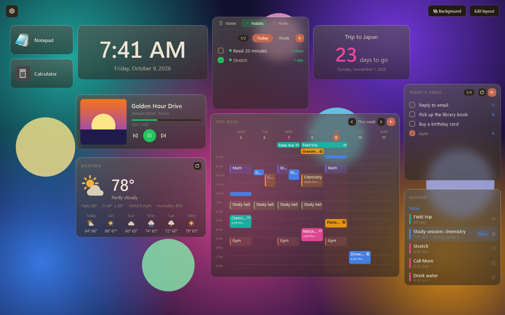
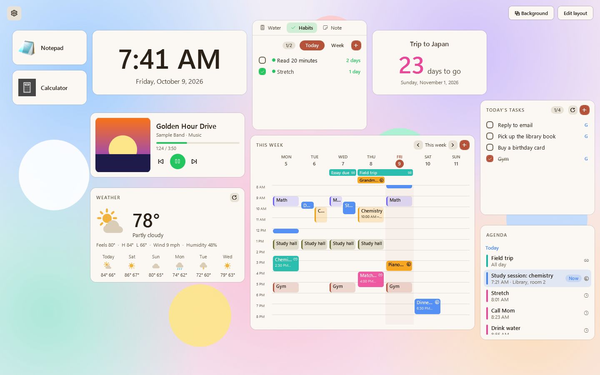
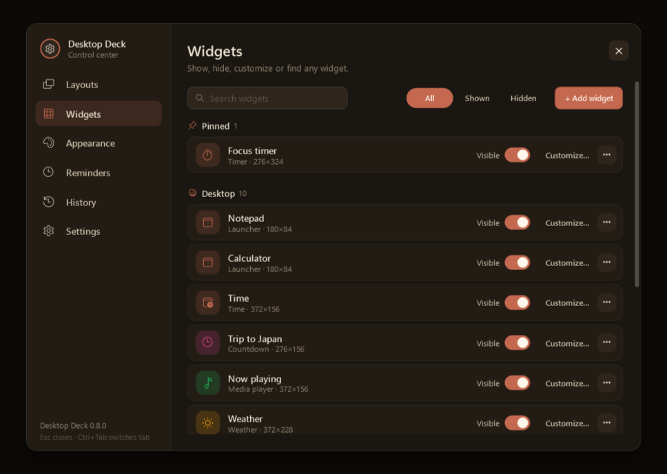
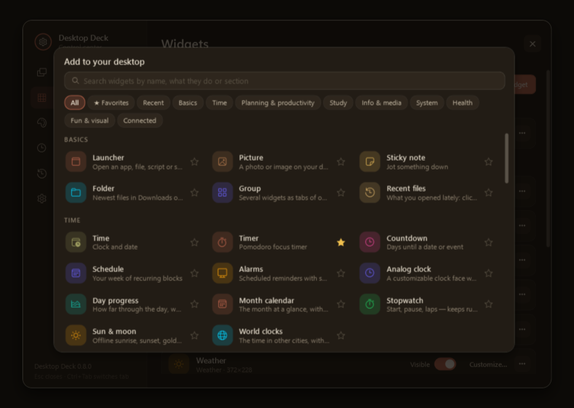
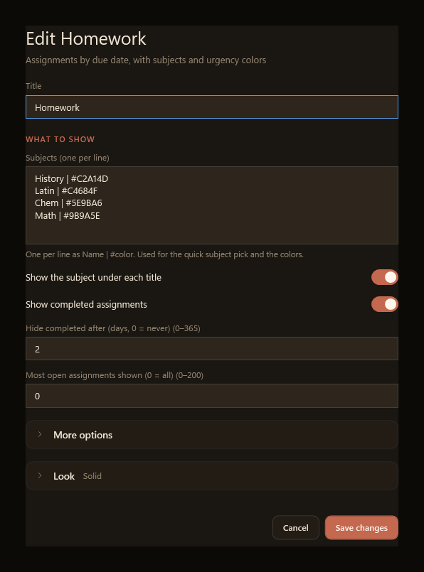
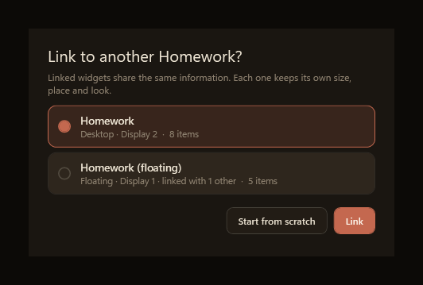
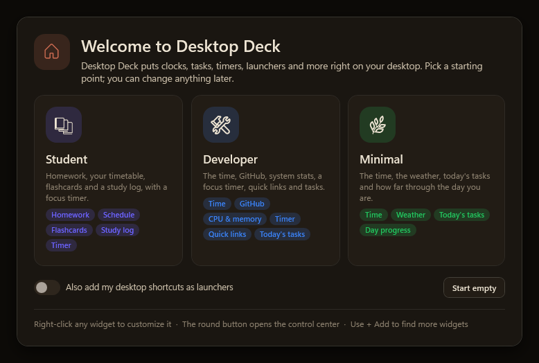

# Desktop Deck

Turn your Windows desktop background into a widget dashboard, on every monitor. Desktop Deck puts launchers, pictures, planners, trackers, timers, system monitors and connected-service cards behind your windows, and lets you bring them forward whenever you want. It is a native C# / WPF app on .NET 10: no web runtime, no telemetry.

The look is a warm, dark "dusk" palette by default, with Light, Midnight, High contrast and fully custom themes.



*Frosted glass cards over a generated background. Everything shown is sample data.*

## Install

1. Download `DesktopDeckSetup-x.y.z.exe` from the project's releases page and run it.
2. Click through the setup and keep **Launch Desktop Deck** ticked on the last page.

That is all: no .NET install and no administrator rights are needed. Setup installs for your account only, into `%LOCALAPPDATA%\Programs\Desktop Deck`, adds **Desktop Deck** to the Start menu, and lists it under Settings > Apps > Installed apps. Running a newer setup over an older install upgrades it and keeps your settings.

The setup program is not code-signed, so Windows SmartScreen may say "Windows protected your PC" the first time. Click **More info**, then **Run anyway**.

To uninstall, open Settings > Apps > Installed apps, choose Desktop Deck and click Uninstall. It asks once whether to also delete your settings, layouts and saved sign-ins; the default is No, so your data stays in `%LOCALAPPDATA%\DesktopDeck` unless you say Yes.

## Features

- **A dashboard on your desktop.** One deck per monitor, attached to the desktop layer behind your windows. Press **Win+D** to see it, or **Ctrl+Alt+D** to bring just your widgets in front.
- **Pinned widgets.** Right-click any widget and choose **Place on screen › Pin on top** to float it above your other windows without stealing focus. A pinned widget can also fade when you are not using it, and let clicks pass through (hold Ctrl over it to use it).
- **Layouts.** Save arrangements of your pinned widgets and of your desktop, switch with one click, from the tray, with a hotkey, or automatically.
- **Automation.** Switch layouts by time of day, by the app in the foreground, or by monitor setup (docked vs. laptop only), and hide pinned widgets while a fullscreen app or game is in front.
- **Themes and appearance.** Built-in and custom palettes, an accent color and a font choice. Card styles are Solid, See-through, Frosted glass, Outline and No card. Give every widget one look, or let a widget keep its own. Text size, corner roundness, color and opacity can also be set per widget.
- **Widget groups.** Combine several widgets as tabs of one card.
- **Linked widgets.** Add a second widget of a kind you already have and choose to link it: the two share their information, while each keeps its own size, place and look.
- **First run.** A new install opens a short welcome with the **Student**, **Developer** and **Minimal** starters, or an empty deck.
- **Undo, recycle bin and history.** Undo and redo changes, restore removed widgets, and go back to an earlier day's layout. **Settings → Keep history for…** chooses how long each kind of history is kept.
- **Reminders.** One-off or repeating reminders you can type in plain words ("call mom tomorrow at 6pm"), with toasts, snooze, quiet hours and a Reminders widget.
- **Connected accounts (optional).** Google Calendar (view and edit), iCal links, Google Tasks sync, read-only Gmail, Google Classroom, GitHub, Notion and OBS Studio. Everything is opt-in and set up with your own credentials.
- **Edit layout** (top right, or **Ctrl+E**): drag to move, resize from the corner, double-click to customize, right-click to lock or remove, and drop files or pictures onto the deck.

## Screenshots

Made from the app's built-in sample deck, so nothing here is real data.



*The same widgets in the Light theme with the default solid cards.*



*The control center: show, hide, customize or find any widget.*



*The gallery (**+ Add**): search, browse by section and star your favorites.*



*Customize shows a widget's own settings first; less used options and the card look stay folded away.*



*Adding a second Homework widget asks whether to link it, so the two share their information.*



*The first-run welcome: pick a starter, or start with an empty deck.*

## Requirements

- Windows 10 (version 2004 or later) or Windows 11
- To build: the [.NET 10 SDK](https://dotnet.microsoft.com/download)
- To run a build made with `dotnet publish`: the .NET 10 Desktop Runtime (the SDK includes it). The installer needs neither

## Build and run

```powershell
dotnet publish src/DesktopDeck/DesktopDeck.csproj -c Release -r win-x64 --self-contained false -o artifacts/app
artifacts\app\DesktopDeck.exe
```

Running the program again while it is open brings your widgets forward. `DesktopDeck.exe --exit` asks a running deck to close.

To build the installer yourself (the first build downloads the Inno Setup compiler from NuGet, so nothing has to be installed):

```powershell
dotnet build installer/DesktopDeck.Installer.csproj -c Release
```

It publishes the app self-contained and writes `artifacts\installer\DesktopDeckSetup-<version>.exe`.

The project targets `net10.0-windows10.0.19041.0` (needed by the media widget), so the first restore downloads the Windows SDK projection pack from NuGet. The app uses no other packages.

## Tests

The three suites are plain console programs that exit non-zero on failure:

```powershell
dotnet run --project tests/DesktopDeck.Tests/DesktopDeck.Tests.csproj -c Release
dotnet run --project tests/DesktopDeck.ServiceTests/DesktopDeck.ServiceTests.csproj -c Release
dotnet run --project tests/DesktopDeck.WidgetTests/DesktopDeck.WidgetTests.csproj -c Release
```

They cover layout geometry, services (settings, layouts, themes, reminders, automation, history, Google helpers, linked widgets) and the pure logic of every widget.

For visual checks, the app has a few command-line switches: `--preview` (an ordinary preview window with isolated temporary settings), `--smoke-test` (renders a preview to `verification/desktop-deck.png` and exits; add `--sample` for made-up data, `--edit`, `--settings`, `--panel <tab>`, `--dialogs`, `--menus`, `--simple`, `--icons` (desktop icons on, into `verification-icons/`), `--front`, or `--widgets [--only <kind>]` to render every plug-in widget), and `--host-test` (attaches to your real desktop and checks the hosting on every monitor, including the desktop-icons behaviour; `--icons` runs it with icons on).

## Using it

- **Control center** (the round control button, the **⚙** on the deck, **Ctrl+Alt+S**, or the tray icon): a panel with six tabs (five in the simple view, which has no Layouts): Layouts, Widgets, Appearance, Reminders, History and Settings. Automation rules are in Layouts, and the display options are in Settings. **Ctrl+Tab** moves between tabs, **Esc** closes it.
- **Add widgets** from the gallery (**+ Add**): search by name, browse by section, star favorites, and see the widgets you added recently.
- **Templates** (Layouts tab): Student, Vibe coding (GitHub, kanban, quick links, timer, media), Focus and Minimal (clock, weather, tasks, media) add a ready-made layout without changing what you see until you switch to it.
- **Display modes** (Settings → Display): On the desktop (the default), Over my apps (Alt+Tab) (a transparent overlay you can Alt+Tab to) and Always on top of my apps.
- **Simple view:** a new install shows fewer menu entries, tabs and buttons (the right-click menu is Customize…, Pin on top, Size, Move to, Hide and Remove…). Turn on **Settings → Show advanced features** for layouts, the Alt+Tab overlay, groups and links, and automation.
- **Right-click menu** (with advanced features on): **Look ›** (copy and paste a look; hidden while a widget follows the shared look), **Place on screen ›** (Pin on top, Lock position, Size (Small, Medium, Large or Default) for any widget, Move to display, and for pinned widgets Fade when idle and Let clicks pass through), **More ›** (Add to group, Link with, Unlink), then Hide and, in Edit layout, Remove.
- **First run:** a new install shows the welcome. Pick a starter, or **Start empty**. You can also choose to add your desktop shortcuts as launchers; Esc skips the welcome.
- **Monitors:** every monitor gets its own deck. Drag a widget across the edge to move it, or right-click and choose **Place on screen › Move to display**. Items from an unplugged monitor show on the main monitor until it returns.
- **Shortcuts:** Ctrl+Alt+D (widgets in front), Ctrl+Alt+S (control center), Ctrl+E (edit layout), and optionally Ctrl+Alt+1...9 for your pinned layouts. A shortcut another app already owns is skipped.
- **Launchers:** programs and batch files are tracked in a Windows job so **Stop** closes only what the deck started; shortcuts and documents opened through the shell are untracked.

## Widgets

Widgets are grouped into sections in the gallery. Every widget has its own **Customize...** options plus shared appearance settings. The Customize window shows the widget's own settings first; less used settings sit behind a collapsed **More options**, and card and color settings behind a collapsed **Look**.

| Section | Widgets |
| --- | --- |
| Basics | Launcher, Picture, Sticky note, Folder, Group, Recent files |
| Time | Time, Timer (pomodoro), Countdown, Schedule (weekly blocks), Day progress, Month calendar, World clocks, Analog clock, Stopwatch, Alarms & reminders, Sun & moon |
| Planning | Today's tasks, Habits, Weekly goals, Counter, Reminders |
| Study | Homework, Flashcards (spaced repetition), Grades & GPA, Periodic table, Study log, Google Classroom |
| Productivity | Quick links, Mini kanban, Daily journal, Inbox, Morning routine, Today's focus |
| Connected | Agenda (Google, iCal and your Schedule), Gmail (read-only), GitHub, Notion, OBS Studio, Bluetooth |
| Info & media | Media player (via Windows media controls), Weather |
| Online | News feeds (RSS/Atom), On this day, Air quality, Exchange rates |
| System | CPU & memory, Drives, Network speed, Battery & power, PC info, Top apps |
| Health | Break reminder (20-20-20), Hydration, Bedtime |
| Fun | Quote of the day, Word of the day, Dice & random, Calculator, Unit converter, Breathing guide |
| Visual | Photo slideshow, Text banner, Color palette, Sticker |
| Tools | Volume |

Online widgets fetch only when you add them, at bounded intervals, keep their last good data when a service is unavailable, and back off after failures. System widgets only observe your PC. Adding your own widget is easy: see [CONTRIBUTING.md](CONTRIBUTING.md).

## Where your data lives

Everything is stored locally in `%LOCALAPPDATA%\DesktopDeck`:

| File | Contents |
| --- | --- |
| `settings.json` | Layouts, widgets and their data, appearance, reminders (with a recovery backup) |
| `secrets.json` | Google sign-in, iCal addresses and widget tokens, encrypted with Windows DPAPI for your account only |
| `snapshots\` | Daily copies of `settings.json` for "Restore a day" |
| `errors.log` | Diagnostics |

Use **Settings > Data > Open data folder** to find it. Uninstalling from Settings > Apps keeps this folder unless you answer Yes to the question about deleting your settings (a silent uninstall always keeps it). If you run a build from a folder instead, turn off **Start when I sign in**, exit from the tray, and delete the app folder (and the data folder if you want your settings gone). See [SECURITY.md](SECURITY.md) for how secrets are handled.

## Network use

There is no telemetry. Desktop Deck only contacts services you have configured:

- Weather and Air quality: Open-Meteo. On this day: Wikimedia. Exchange rates: a public rates API. News feeds: the feed URLs you enter.
- Google (only after you connect an account): accounts.google.com, oauth2.googleapis.com and the Google APIs for the features you enable. iCal links: the hosts you add.
- GitHub and Notion: their APIs, only when those widgets are set up. OBS: a WebSocket on your own PC.

## Connected accounts (optional)

Everything here is optional, and you bring your own credentials. Desktop Deck never ships a Google OAuth client, so nothing is shared with anyone else.

### Google (Calendar, Tasks, Gmail, Classroom)

Desktop Deck signs in with OAuth 2.0 for installed apps (authorization code with PKCE and a loopback redirect to `http://127.0.0.1:<free port>/`). One-time setup in **Settings > Connected accounts**:

1. Open the [Google Cloud console](https://console.cloud.google.com/) and create a project.
2. APIs & Services > Library: enable **Google Calendar API**. Later, enable **Google Tasks API**, **Gmail API** and **Google Classroom API** for the features you want.
3. OAuth consent screen: choose **External** and add your own Google address as a **test user**. In Testing mode Google expires the sign-in after 7 days; publishing the app ("In production") avoids that. Google warns that the app is unverified; it is your own app, so choose Advanced > continue.
4. Credentials > Create credentials > **OAuth client ID** > application type **Desktop app**.
5. Paste the client ID and secret into **Connect**. Your browser opens Google's consent page.

Then enable features one at a time under **Google features**; each asks Google for just its own permission:

| Feature | Scope(s) | Used by |
| --- | --- | --- |
| Calendar | `calendar.events`, `calendar.readonly` (plus `openid`, `email` to show the account) | Schedule and Agenda widgets, adding and editing events |
| Tasks | `tasks` | Two-way sync with Today's tasks |
| Gmail | `gmail.readonly` | Gmail widget (message metadata only: it never reads bodies or attachments and cannot send, change or delete mail) |
| Classroom | `classroom.courses.readonly`, `classroom.coursework.me.readonly`, `classroom.student-submissions.me.readonly` | Google Classroom widget |

Gmail is one of Google's restricted permissions, so with a personal client you will see an "unverified app" warning; that is expected. Many school and company Google Workspace admins block third-party apps, and the widget says so when that happens. **Disconnect** revokes the grant at Google and removes the saved sign-in.

### iCal links (read-only calendars)

Add any number of private `.ics` addresses with a label and color (Google Calendar: Settings > your calendar > "Secret address in iCal format"; Outlook, Apple and school calendars have similar links). Repeating events, exceptions and time zones are handled. The address is stored encrypted, because it works like a password.

### GitHub, Notion and OBS

- **GitHub:** click *Connect GitHub...* on the widget and paste a classic personal access token with the `notifications` and `repo` scopes.
- **Notion:** create an internal integration at notion.so/my-integrations, add it to your database (... > Connections), then paste the integration secret and the database link into the widget.
- **OBS Studio:** in OBS, turn on Tools > WebSocket Server Settings > Enable WebSocket server (port 4455). If it has a password, click *Enter password...* on the widget.

## Known limits

- Desktop attachment relies on Explorer's internal window structure, so a Windows update can require an adjustment. The tray's **Reconnect** retries; details go to `errors.log`.
- Text is typed into small dialog windows, because keyboard input to a window hosted inside Explorer's desktop layer is unreliable. The front layer is a normal window, so shortcuts work there.
- Desktop icons: with Settings → Display → Show desktop icons on (the default for new installs), your Windows icons, wallpaper and desktop menu work as usual everywhere except under a widget; the deck draws the Windows wallpaper behind its widgets and new widgets are placed beside the icons. Icons are hidden while you use Edit layout and come back on Done. With the switch off the deck covers them while it runs and they reappear when it exits.
- Layout uses each monitor's usable work area (excluding the taskbar).
- More live widgets mean more CPU, memory and network use; measure on your own machine.

## Contributing, security and license

- [CONTRIBUTING.md](CONTRIBUTING.md): building, testing and writing a widget
- [SECURITY.md](SECURITY.md): how secrets are stored and how to report a vulnerability
- [LICENSE](LICENSE): MIT
